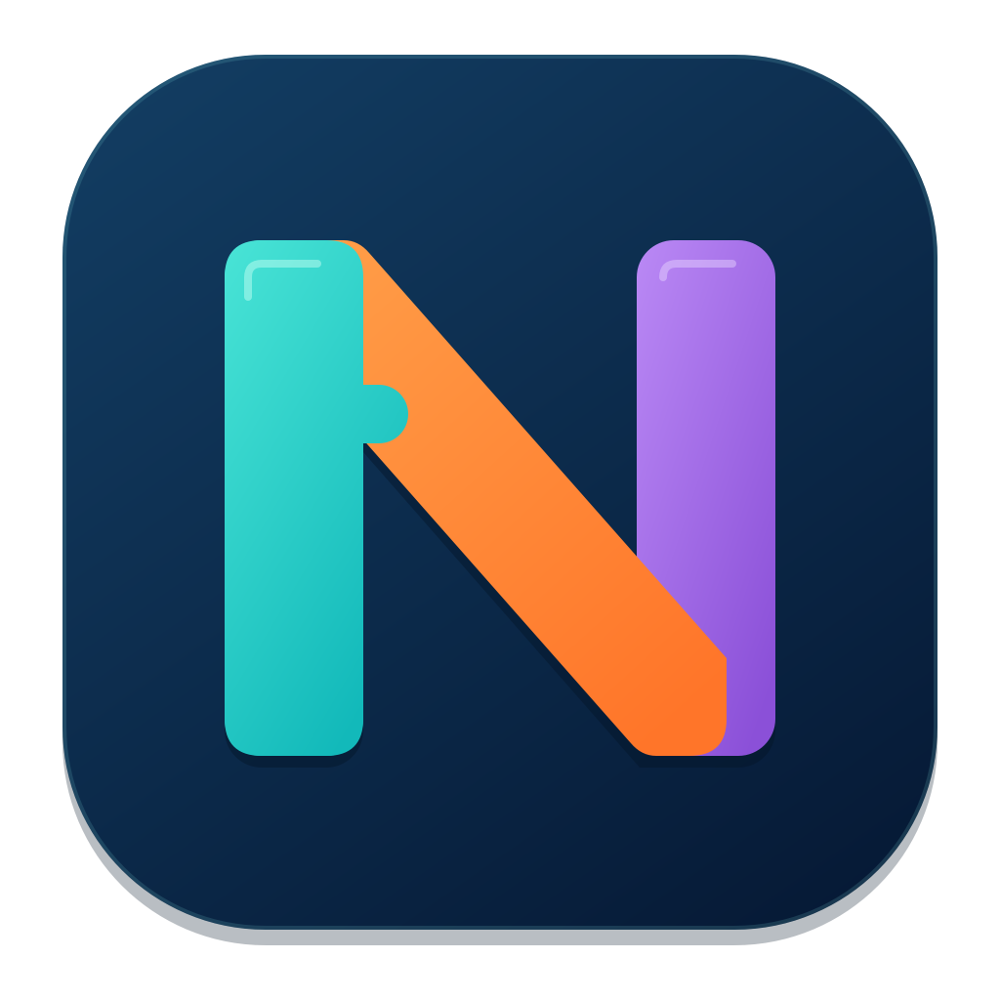

  

# NEXA — Trợ lý AI trên máy tính của bạn

**Giọng nói tiếng Việt · Điều khiển Windows · Cử chỉ tay · Sáng tạo 3D · Hỗ trợ lập trình**

Một sản phẩm của **NXS MEDIA** — được phát triển bởi **Nguyễn Xuân Sơn**.

**Windows 10/11 64-bit · Bộ cài NEXA-Setup.exe · Phiên bản ứng dụng 1.7.2**

---

## NEXA là gì?

NEXA là ứng dụng trợ lý AI dành cho PC và laptop Windows, giúp bạn làm việc với máy tính bằng giọng nói tiếng Việt, văn bản và cử chỉ tay. Từ mở ứng dụng, sắp xếp cửa sổ, điều chỉnh âm lượng đến trò chuyện, soạn nội dung, viết code và tạo mô hình 3D, NEXA tập hợp các công cụ trong một giao diện điều khiển chung.

Bạn có thể gõ yêu cầu, bấm nút nói hoặc đánh thức NEXA bằng tiếng vỗ tay khi ứng dụng đang chạy. Giao diện trung tâm hiển thị quả cầu phản ứng theo trạng thái, kết nối thiết bị, tiến độ tác vụ và lịch sử hoạt động để bạn theo dõi những gì đang diễn ra.

NEXA kết hợp xử lý cục bộ với AI trực tuyến: nhận dạng giọng nói và cử chỉ chạy trên máy; hội thoại và các yêu cầu cần suy luận sử dụng Gemini. Khi mất kết nối AI, các lệnh cơ bản được hỗ trợ vẫn có thể hoạt động.

## Tải và cài đặt

Bản phát hành Windows được đóng gói trong **một file duy nhất**:

**[NEXA-Setup.exe](release/NEXA-Setup.exe)** — khoảng **2,91 GB**.

Bản rà soát ngày **05/10/2026**: thư mục chỉ gồm file chia sẻ nằm tại
`release/final-20261005/publish`. Có checksum SHA-256 và hướng dẫn tiếng Việt.
Xem [báo cáo kiểm thử phát hành](docs/release_audit_2026-10-05.md) để biết kết quả
kiểm tra module, cài đặt, CPU/GPU và phạm vi chưa kiểm chứng trên máy khác.

Liên kết trên trỏ đến file trong thư mục dự án. Khi chia sẻ công khai, nhà phát hành cần upload file này lên Google Drive và cung cấp đường dẫn tải; README hiện chưa có link Drive công khai.

### Ba bước bắt đầu

1. Tải `NEXA-Setup.exe` về máy Windows 10/11 64-bit.
2. Mở file và hoàn tất cài đặt.
3. Mở **NEXA** từ Desktop hoặc Start Menu, rồi nhập một câu lệnh để bắt đầu.

**Bản bộ cài hiện tại đã có Python, thư viện, model nhận dạng giọng nói CPU/GPU và model nhận diện tay/mặt. Người dùng không cần tự cài các thư viện này hoặc nhập API key để sử dụng cấu hình AI đi kèm.**

Bộ cài cài ứng dụng cho tài khoản Windows hiện tại vào `%LOCALAPPDATA%\Programs\NEXA`. Có thể gỡ ứng dụng trong danh sách ứng dụng đã cài của Windows.

### Điều kiện sử dụng

| Thành phần | Yêu cầu |
| --- | --- |
| Hệ điều hành | Windows 10/11 64-bit; chưa có bản macOS hoặc Linux |
| Kết nối Internet | Cần cho Gemini, giọng đọc trực tuyến và dịch vụ tạo 3D đám mây |
| Microphone | Cần khi dùng giọng nói hoặc đánh thức bằng vỗ tay; vẫn có thể nhập bằng bàn phím |
| Camera | Cần khi bật cử chỉ tay hoặc nhận diện sự hiện diện |
| GPU NVIDIA | Không bắt buộc; nhận dạng giọng nói có đường chạy bằng CPU |
| Dung lượng lưu trữ | Cần chỗ cho file tải về và dữ liệu sau giải nén; dung lượng cài lớn hơn file bộ cài |

Model đã kèm sẵn phục vụ cấu hình mặc định. Nếu đổi sang model khác, ứng dụng có thể cần tải thêm. Hiệu năng phụ thuộc CPU/GPU, thiết bị âm thanh, ánh sáng và tác vụ đang chạy.

### API trong bản phát hành

Bản bộ cài hiện tại có sẵn cấu hình API dùng chung của nhà phát hành. Khả năng sử dụng AI phụ thuộc vào kết nối, trạng thái dịch vụ, hiệu lực API và quota còn lại; **không phải gói AI không giới hạn**.

Cấu hình này nằm trên máy người dùng và có thể bị trích xuất. Với nhà phát hành, chia sẻ bộ cài cũng đồng nghĩa phân phối credential dùng chung. Phát hành rộng rãi nên chuyển sang backend quản lý API và hạn mức; bản hiện tại chưa có backend đó.

## NEXA giúp bạn làm gì?

### Điều khiển máy tính bằng tiếng Việt

Mở ứng dụng, tìm kiếm trên web, gõ nội dung, thao tác bàn phím/chuột, điều chỉnh âm lượng, chụp màn hình, quản lý tệp và sắp xếp cửa sổ bằng các câu lệnh được hỗ trợ.

NEXA có công cụ cho nhiều màn hình, thu nhỏ/khôi phục cửa sổ và đặt cửa sổ cạnh giao diện trợ lý. Với ứng dụng có quyền cao hơn hoặc thao tác mà Windows hạn chế, NEXA có thể không thực hiện được.

### Trò chuyện và soạn nội dung cùng AI

Hỏi đáp, giải thích, lên ý tưởng và soạn bản nháp bằng Gemini. Chế độ **Tâm sự** cho phép trò chuyện nối tiếp sau mỗi câu trả lời; trong chế độ này, lời kể được dùng để hội thoại, không chạy lệnh điều khiển máy tính.

Có thể bật lưu hội thoại văn bản trên thiết bị trong phần cài đặt. Mặc định, lịch sử hội thoại không được lưu qua phiên. Nội dung cần AI xử lý được gửi tới dịch vụ AI; đây không phải hội thoại hoàn toàn ngoại tuyến.

### Đánh thức bằng vỗ tay

Khi NEXA đang mở ở chế độ chờ, bạn có thể vỗ tay để đánh thức và bắt đầu nói. Có tùy chọn một hoặc hai tiếng vỗ tay, điều chỉnh độ nhạy và hiệu chuẩn tiếng ồn nền.

Tiếng vỗ tay **không bật được máy đã tắt hoặc đánh thức máy đang ngủ thật**. Chế độ canh gác giữ máy hoạt động trong những điều kiện hỗ trợ để ứng dụng tiếp tục nghe khi màn hình tắt; có thể ảnh hưởng mức tiêu thụ pin và hành vi nguồn điện.

### Điều khiển bằng cử chỉ tay

Dùng webcam để nhận diện tư thế bàn tay và thao tác mà không cần chạm chuột. Ánh xạ cử chỉ hệ thống mặc định gồm:

| Cử chỉ | Tác dụng |
| --- | --- |
| Chỉ ngón trỏ sang phải, giữ yên | Chuyển cửa sổ sang màn hình đích đã cấu hình |
| Ngón cái hướng xuống | Thu nhỏ cửa sổ |
| Ngón cái hướng lên | Khôi phục cửa sổ vừa thu nhỏ bằng NEXA |
| Nắm tay | Tạm dừng video mục tiêu |
| Xòe bàn tay sau khi nắm tay | Phát tiếp video vừa tạm dừng |
| Giơ hai ngón trỏ và giữa | Cuộn lên trong chế độ cử chỉ hệ thống |

NEXA còn có chế độ chuột bằng tay. Khi bảng code hoặc trình xem 3D đang nhận điều khiển, cử chỉ chuyển sang thao tác theo ngữ cảnh tương ứng. Hiệu quả nhận diện phụ thuộc camera, khoảng cách và ánh sáng; xem [hướng dẫn cử chỉ](docs/gestures.md).

### Điều khiển nội dung đa phương tiện

Điều chỉnh âm lượng và điều khiển phát/tạm dừng nội dung được hỗ trợ. Với YouTube, NEXA Bridge giúp làm việc với tab trình duyệt cụ thể; khi không có Bridge, một số thao tác có thể dùng bộ điều khiển media của Windows.

**Tích hợp trình duyệt nâng cao vẫn cần cài extension và đăng ký Native Messaging host.** Bộ cài đã có `NexaBridge.exe`, nên phần host không cần Python riêng. Xem [hướng dẫn bộ cài](docs/windows_release.md) và [tài liệu Browser Bridge](browser_bridge/README.md); các hướng dẫn dùng `.venv` trong tài liệu Bridge dành cho bản mã nguồn.

### Tạo và tương tác với mô hình 3D

Mô tả vật thể bằng tiếng Việt, bổ sung thông số hoặc chọn ảnh tham chiếu để tạo mô hình theo phương pháp được hỗ trợ. NEXA có:

- Dựng CAD tham số cục bộ cho các nhóm vật thể có template.
- Thiết kế hình học qua AI và các tuyến tạo hình từ dịch vụ đám mây.
- Trình xem để xoay, phóng to, quan sát mô hình và thao tác bộ phận với mô hình có cấu trúc lắp ráp phù hợp.
- Hiển thị tiến độ tạo hình, kết quả kiểm tra và lưu mô hình trong thư viện.
- Công cụ xuất hình ảnh/video sản phẩm theo khả năng hiện có.

Các tuyến cloud phụ thuộc nhà cung cấp, quota và credential tương ứng; cấu hình Gemini không đồng nghĩa mọi dịch vụ 3D đã được kích hoạt. Mô hình dựng từ ảnh không mặc nhiên có cấu trúc tháo lắp.

CAD hiện sử dụng mesh/CSG, chưa có STEP/B-rep. Kết quả và điểm đánh giá AI chưa thay thế kiểm chứng kích thước, vật liệu, dung sai hoặc khả năng chế tạo thực tế. Chi tiết: [không gian 3D](docs/three_d.md).

### Hỗ trợ viết và chạy thử code

Mô tả chương trình bạn cần, xem mã được sinh theo từng tệp, yêu cầu sửa tiếp, lưu hoặc chạy thử. NEXA có tô màu cú pháp, kiểm tra tĩnh cho các ngôn ngữ được hỗ trợ và luồng sửa lỗi dựa trên kết quả kiểm tra.

**Chạy NEXA không cần cài Python riêng, nhưng chạy chương trình do NEXA sinh có thể cần runtime, compiler và thư viện của chương trình đó.** Ví dụ, một dự án JavaScript hoặc C++ vẫn cần môi trường phù hợp trên máy.

Code sinh bởi AI cần được xem lại trước khi chạy. Luồng chạy thử có giới hạn và kiểm soát riêng nhưng không phải sandbox cách ly hệ điều hành. Xem [hướng dẫn sinh code](docs/code.md).

## Dùng thử trong vài phút

Sau khi mở NEXA, bắt đầu bằng cách gõ để xác nhận ứng dụng hoạt động, rồi thử giọng nói và camera nếu cần.

| Bạn nói hoặc gõ | Kết quả mong đợi |
| --- | --- |
| “Mở Notepad” | Mở ứng dụng ghi chú |
| “Đặt âm lượng 30 phần trăm” | Điều chỉnh âm lượng Windows |
| “Tìm trên web cách học Python” | Mở tìm kiếm trong trình duyệt |
| “Chụp màn hình” | Lưu ảnh chụp cục bộ |
| “Thu nhỏ cửa sổ” | Thu nhỏ cửa sổ mục tiêu |
| “Nexa, bật điều khiển bằng tay” | Bật camera cho chế độ cử chỉ |
| “Nexa, tôi muốn tâm sự với em” | Chuyển sang chế độ trò chuyện |
| “Viết code Python đọc file CSV và tính tổng theo tháng” | Bắt đầu yêu cầu sinh code |
| “Tạo bu-lông M8 dài 30 mm” | Bắt đầu yêu cầu mô hình 3D, có thể hỏi thêm thông số |
| “Nexa, nghỉ đi” | Trở về chế độ chờ |

NEXA có thể hỏi lại khi yêu cầu thiếu thông tin. Khả năng hiểu các cách diễn đạt linh hoạt phụ thuộc AI và chất lượng nhận dạng giọng nói.

**Hai phím tắt cần nhớ:**

- **Ctrl + Alt + N:** đánh thức NEXA.
- **Ctrl + Alt + Esc:** dừng khẩn cấp, hủy tác vụ và nhả phím/chuột mà NEXA đang giữ.

Nếu đã dừng khẩn cấp, cần tiếp tục điều khiển trên giao diện trước khi chạy các thao tác mới.

## Chức năng nào dùng được khi không có Internet?

| Nhóm chức năng | Hoạt động ngoại tuyến |
| --- | --- |
| Giao diện, nhập lệnh, hiển thị trạng thái máy | Có |
| Phát hiện vỗ tay, nhận dạng giọng nói với model đã có | Có |
| Nhận diện cử chỉ với model đã có | Có |
| Các lệnh Windows cơ bản được hỗ trợ | Có; hành động mở web vẫn cần mạng để xem nội dung |
| CAD tham số cục bộ cho nhóm có template, xem mô hình đã lưu | Có |
| Trò chuyện Gemini, soạn nội dung, sinh code bằng AI | Không |
| Tạo hình/đánh giá ảnh qua AI hoặc dịch vụ cloud | Không |
| Giọng đọc trực tuyến | Không; giọng Windows ngoại tuyến phụ thuộc giọng đã cài |

Không có Internet không làm mất toàn bộ chức năng NEXA, nhưng không thể thay thế những tác vụ vốn cần dịch vụ trực tuyến.

## Quyền điều khiển và dữ liệu

NEXA có cơ chế xác nhận cho các hành động được đánh dấu nhạy cảm và nút dừng khẩn cấp. Ứng dụng vẫn chịu giới hạn quyền của Windows; chạy bằng quyền thường không cho phép tự vượt UAC hoặc điều khiển mọi cửa sổ quản trị.

Nhận dạng giọng nói và cử chỉ được xử lý cục bộ. Văn bản hội thoại/yêu cầu cần AI sẽ được gửi tới Gemini. Chức năng đọc màn hình bằng AI chỉ sử dụng khi được bật và đi qua luồng xác nhận gửi ảnh. Các dịch vụ tạo 3D trực tuyến có thể nhận mô tả hoặc ảnh tham chiếu theo tác vụ bạn chọn.

Mặc định không bật thu corpus âm thanh nghiên cứu hoặc lưu hội thoại qua phiên. Nếu chủ động bật các tùy chọn này, dữ liệu tương ứng sẽ được lưu cục bộ theo cấu hình. Lịch sử hội thoại lưu trên máy là văn bản, không phải kho dữ liệu mã hóa.

Tự mở khóa Windows là **tùy chọn riêng, mặc định tắt**, cần dịch vụ và thiết lập bổ sung. Việc cài NEXA không tự cấu hình mã mở khóa cho người dùng. Tiếng nói hoặc tiếng vỗ tay không phải phương thức xác thực danh tính.

## Những giới hạn cần biết

- Độ chính xác giọng nói/cử chỉ thay đổi theo môi trường và thiết bị; có thể cần chọn lại mic hoặc hiệu chuẩn.
- Khi NEXA đang đọc câu trả lời, luồng nghe được kiểm soát để tránh vọng loa; chưa có hội thoại full duplex hay ngắt lời tự nhiên bằng giọng nói.
- Tác vụ AI có thể chậm hoặc thất bại do mạng, quota hoặc nhà cung cấp. Bản phát hành không bảo đảm mọi dịch vụ cloud luôn hoạt động.
- Các ứng dụng đặc thù, cửa sổ quyền cao hoặc fullscreen độc quyền có thể hạn chế thao tác tự động.
- Chưa có kết quả chứng nhận tương thích trên mọi cấu hình Windows. Bộ cài hiện chưa ký số.

## Nhận diện NEXA — NXS MEDIA

Logo NEXA sử dụng chữ **N** từ ba phần nối nhau, kết hợp **xanh ngọc, cam và tím** trên nền **navy**. Chi tiết đầu nối gợi hình mảnh ghép trong nhận diện NXS MEDIA; hình khối được giữ rõ để dùng ở kích thước icon desktop.

| Tài nguyên | Mục đích |
| --- | --- |
| [Logo SVG](assets/branding/nexa-icon.svg) | Bản vector có thể chỉnh sửa và phóng lớn |
| [Logo PNG](assets/branding/nexa-icon.png) | Ảnh nền trong suốt cho giới thiệu sản phẩm |
| [Icon Windows ICO](assets/branding/nexa-icon.ico) | Icon đa kích thước cho ứng dụng và bộ cài |

## Trạng thái bản phát hành

Bộ cài được tạo và kiểm tra ngày **05/10/2026**. Phiên bản ứng dụng và installer hiện ghi **1.7.2**; các nhãn phiên bản trong tài liệu phát triển cũ không phải số phiên bản bộ cài mới.

| Hạng mục | Kết quả đã ghi nhận |
| --- | --- |
| Tạo bộ cài một file `NEXA-Setup.exe` | Thành công; 2.906.089.683 byte |
| Cài vào thư mục kiểm thử trên máy hiện tại | Thành công |
| Khởi động giao diện và chụp ảnh giao diện | Thành công |
| Nạp model nhận giọng nói CPU với chế độ không tải từ Hugging Face | Thành công |
| Kiểm tra module/template từ EXE | Đạt |
| Đối chiếu mã đóng gói với mã nguồn ở thời điểm build | 181 module khớp |
| Kiểm tra Native host: origin hợp lệ/không hợp lệ và kết thúc luồng vào | Đạt |
| Một yêu cầu Gemini ngắn bằng cấu hình API của bản phát hành | Thành công |
| Thoát ứng dụng và gỡ bản cài thử | Thành công |
| Kiểm thử trên máy Windows sạch khác | Chưa thực hiện |
| Ký số bộ cài | Chưa thực hiện |

Kết quả trên xác nhận những bước đã kiểm tra, không có nghĩa mọi thao tác camera, đa màn hình, cloud 3D hoặc điều khiển ứng dụng thật đều đã được nghiệm thu. Báo cáo của đợt build nằm tại [release/verification/release.json](release/verification/release.json); mã kiểm tra file nằm tại [NEXA-Setup.exe.sha256](release/NEXA-Setup.exe.sha256). Các file trong `release` được tạo cục bộ và không được đưa vào Git.

## Khắc phục nhanh

| Tình huống | Việc nên kiểm tra |
| --- | --- |
| Mic không nhận tiếng | Chọn đúng thiết bị trong NEXA và kiểm tra quyền microphone của Windows |
| Vỗ tay không đánh thức hoặc đánh thức nhầm | Hiệu chuẩn nền ồn, điều chỉnh độ nhạy hoặc dùng hai tiếng vỗ tay |
| Camera không mở | Kiểm tra quyền camera, chọn đúng camera và đóng ứng dụng đang chiếm thiết bị |
| AI báo lỗi hoặc về chế độ cơ bản | Kiểm tra Internet, thông báo trạng thái AI; API dùng chung có thể hết quota hoặc không còn hiệu lực |
| Không có giọng đọc | Kiểm tra thiết bị phát, kết nối và backend giọng nói; giọng offline phụ thuộc Windows |
| Không điều khiển đúng tab YouTube | Kiểm tra extension NEXA Bridge, đăng ký host và tab mục tiêu |
| Code tạo ra không chạy được | Xem thông báo runtime/compiler hoặc thư viện còn thiếu của chương trình được tạo |
| Một thao tác không dừng như mong muốn | Dùng Ctrl + Alt + Esc hoặc nút Dừng khẩn cấp |

## Dành cho người phát triển

Người sử dụng bộ cài không cần thực hiện phần này. Để chạy từ mã nguồn, dùng Python 3.11 64-bit, chạy `setup_windows.bat`, cấu hình AI cục bộ rồi mở `start_windows.bat`. Bản mã nguồn mẫu không chứa API thật; việc cấu hình API sẵn chỉ áp dụng cho bộ cài chia sẻ đã được chuẩn bị.

Các thành phần chính: Python, PySide6/Qt Quick, faster-whisper, MediaPipe, Google Gen AI SDK và các công cụ Windows. Code nằm trong `nexa`, giao diện QML trong `nexa/ui/qml`, tài nguyên trong `assets`, script phát triển/đóng gói trong `scripts`.

NEXA cũng có workspace **EDU** với mô phỏng STEM và phòng thí nghiệm ảo chạy cục bộ. Xem [tài liệu NEXA Edu](docs/education.md).

| Tài liệu | Nội dung |
| --- | --- |
| [Đóng gói Windows](docs/windows_release.md) | Quy trình build EXE, chuẩn bị model/API, installer và kiểm tra |
| [Cử chỉ và chuột bằng tay](docs/gestures.md) | Ánh xạ, hiệu chuẩn và thao tác theo ngữ cảnh |
| [Nhiều màn hình](docs/dual_monitor.md) | Chọn màn hình nguồn/đích và quản lý cửa sổ |
| [Browser Bridge](browser_bridge/README.md) | Extension, Native Messaging và kết nối trình duyệt |
| [Mô hình 3D](docs/three_d.md) | Phương pháp dựng hình, viewer, nhà cung cấp và giới hạn |
| [Sinh code](docs/code.md) | Viết, kiểm tra, sửa và chạy thử chương trình |
| [Tiến độ tạo nội dung](docs/generation_progress.md) | Hiển thị trạng thái các tác vụ sinh nội dung |
| [Kiểm thử thủ công](docs/manual_tests.md) | Những tình huống cần xác minh trên thiết bị thật |
| [Cập nhật sau rà soát](docs/update_2026-10-03.md) | Sửa lỗi, kiểm chứng và giới hạn của đợt cập nhật |

Để chia sẻ bản đã đóng gói, chỉ upload **`release/NEXA-Setup.exe`**. Không cần upload mã nguồn, `.venv` hoặc cả thư mục dự án. Hướng dẫn build và lưu ý về credential dành cho nhà phát hành được ghi trong tài liệu đóng gói Windows.

---

**NEXA — by NXS MEDIA**

Trợ lý AI tiếng Việt cho công việc trên máy tính.
